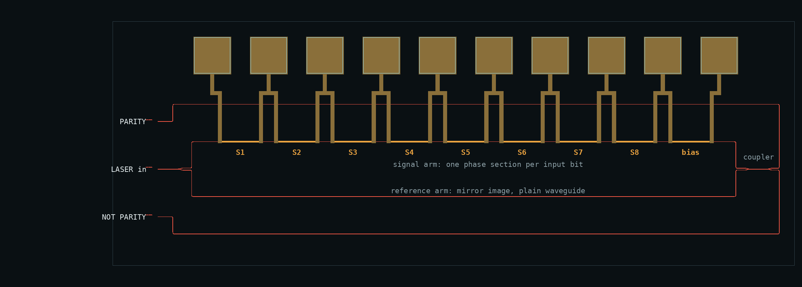
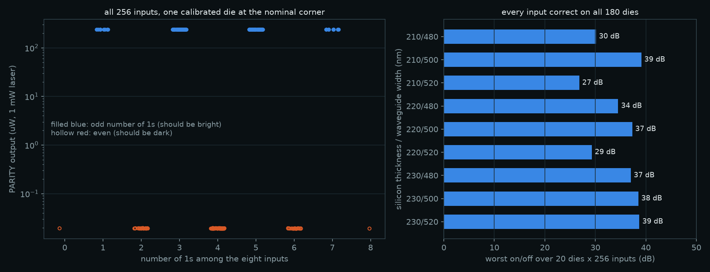
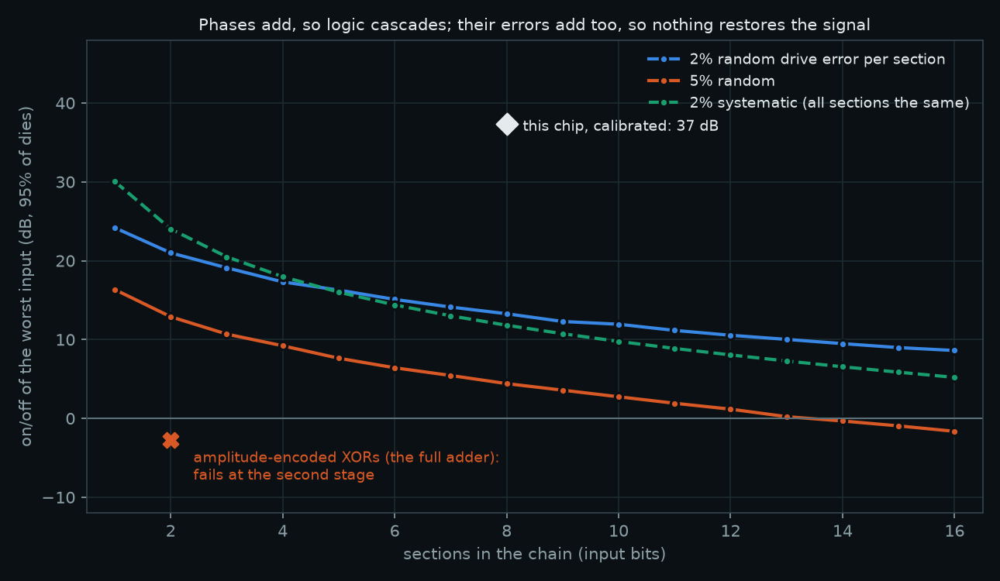
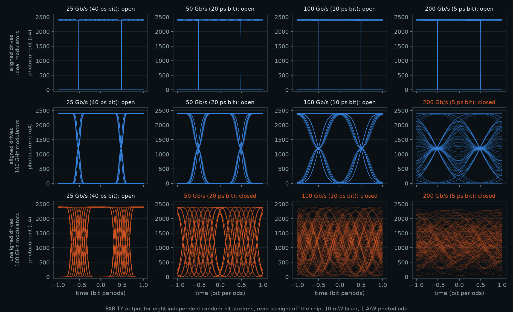
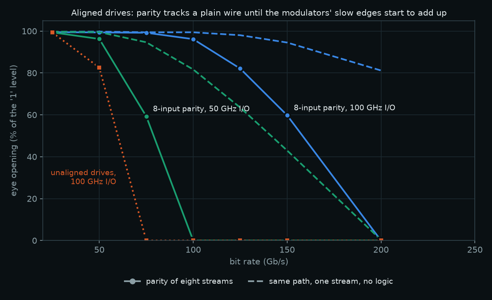
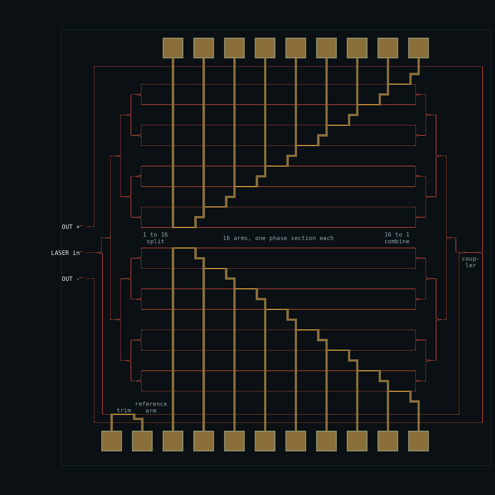
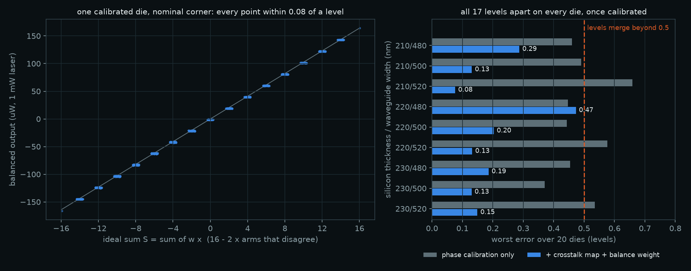
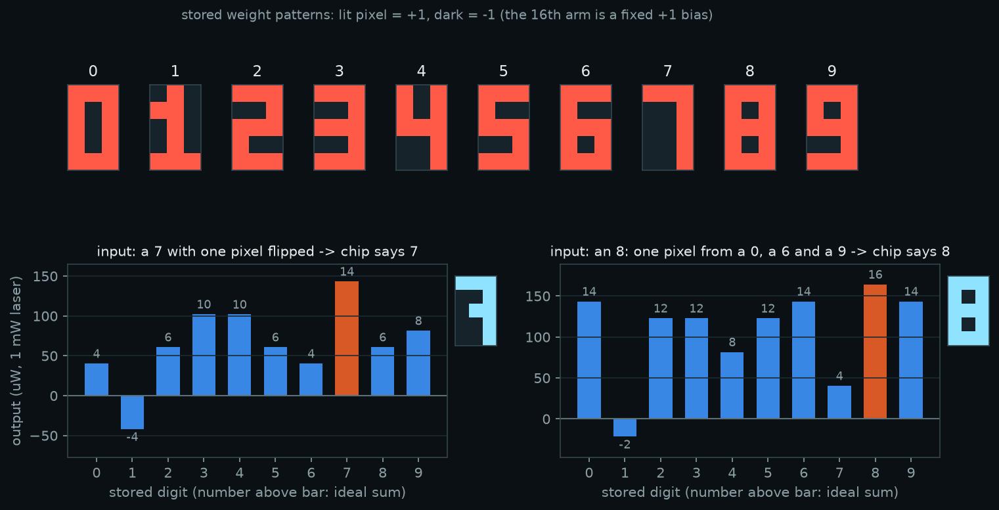
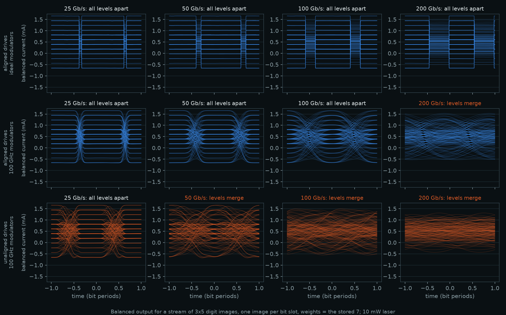
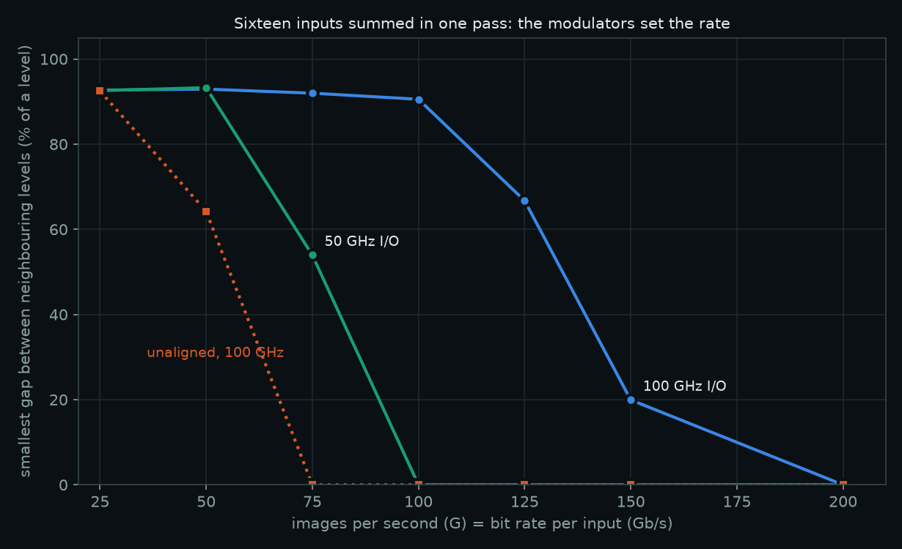

# Optical full adder chip, 4-bit ALU, parity chip and optical neuron

A silicon photonic version of the full adder in *Using Polarisation and Interference for Optical Computing* (Section 4.2, Figures 15–16), designed for the SiEPIC EBeam process run by Applied Nanotools: 220 nm silicon waveguides, TiW heaters (M1) and a metal routing layer (M2).


The layout is a native KLayout / SiEPIC-Tools design, `klayout/EBeam_heaters_atharvdubey_FullAdder.gds` (and `.oas`, the fabrication export). It measures 1.87 × 1.60 mm and holds 113 components, ten grating couplers and twelve probe pads. It passes SiEPIC-Tools' functional verification with 0 errors. It has not been fabricated.

Four copies of it make a 4-bit ALU (ADD, SUB, AND, OR, XOR) on one 3.72 × 3.08 mm die: see [4-bit ALU](#4-bit-alu) below.

A third chip fixes the full adder's cascade problem by encoding bits as phase: eight inputs, one pass of light, no detection in between. See [Phase-encoded parity](#phase-encoded-parity) below.

A fourth puts the phase sections side by side: sixteen inputs summed in one pass, a binary-weight neuron that recognises 3 × 5 pixel digits. See [Optical neuron](#optical-neuron) below.

The 4-bit ALU can be tried as a calculator on the [ALU page](../alu/), the parity chip on the [parity page](../parity/), the neuron on the [neuron page](../perceptron/), and the project is summarised in [`CONCEPT.md`](../CONCEPT.md).

How fast the interference logic itself can compute is in [`speed/`](speed/README.md): a single-pass version of the paper's XOR runs at 200 Gb/s with 100 GHz modulators and adds 5 ps.

Open either layout in KLayout with SiEPIC-Tools and the SiEPIC EBeam PDK installed. The EBeam technology then gives the layer colours and the PCells, so every waveguide and heater stays editable.

## From the bench to the chip

| Bench (Fig. 15/16) | Chip |
|---|---|
| Laser | External 1550 nm laser, split 50/50 in fibre into the two blocks' grating couplers |
| S1 (1): carry-in light | The fibre splitter (each block has its own laser coupler; see below) |
| S2 (2), S3 (3): inputs A, B for AND gate 1 | Y-branch taps Sa, Sb in block 1 |
| S4 (8) with mirrors 7, 9: XOR gate 1 | Michelson interferometer: broadband directional coupler, Sagnac loop mirrors |
| S5 (10), S6 (13) with mirrors 11, 12: AND gate 2, XOR gate 2 | Block 2, the same circuit as block 1 |
| Blocking a beam to set an input | Thermo-optic Mach–Zehnder switch in that branch or interferometer arm |
| Polarisers marking the intensities | The same switches, set to partial transmission |
| One "OR" photoresistor for the carry | Four carry outputs on photodiodes wired in parallel, so their currents add |
| Lenses, screen and hole on a dark fringe | Interferometer output port biased dark with a heater |
| Arduino threshold | Comparators |

### One change from Figure 15

The figure sends XOR 1's light into XOR 2. That cannot work with light alone. XOR 1 is dark when A and B are both open because their light arrives with opposite phase. So "only A" and "only B" leave XOR 1 with opposite phase (172° apart in the simulation). When that light is combined with the carry-in beam, one of the two cases cancels and the other doubles. No carry-in phase or power fixes both (below).

On the chip, XOR 1 is therefore read by a photodiode and comparator. Its result, X, drives the X switches of block 2, in the same way the bench's Arduino applied its threshold. Everything else follows the paper's arrangement.


### Two test circuits

SiEPIC's automated test station uses one laser fibre and three detector fibres: one coupler above the laser input and two below it, at 127 µm pitch (the `DFT_Phot1x` design-for-test rules). Each block is therefore its own test circuit:

| Block 1 (A, B): the paper's half adder | Block 2 (Cin, X): the second half adder |
|---|---|
| y = 381 µm: XOR 1 (detector) | y = −381 µm: SUM (detector) |
| y = 254 µm: LASER 1 (`opt_in` label) | y = −508 µm: LASER 2 (`opt_in` label) |
| y = 127 µm: carry branch a, input A | y = −635 µm: carry branch c, Cin |
| y = 0 µm: carry branch b, input B | y = −762 µm: carry branch d, X |

This is the textbook full adder of the paper's Figure 12: two half adders, with their carries combined. Here the carries are combined by adding photocurrents. For use as one adder, one laser feeds both blocks through a 50/50 fibre splitter. A loopback pair at y = 508 and 635 µm is for aligning the fibre array.

## Simulation

`full_adder_sim.py` simulates the chip exactly as drawn. `klayout/full_adder_siepic.py` runs SiEPIC-Tools' net extraction on the layout (which pins touch which) and writes `klayout/extracted_netlist.json` with every component and every waveguide's drawn length. The simulation turns that file into one SAX scattering network, so the topology is never typed in by hand.

- **Component models:** the SiEPIC EBeam PDK compact models, via simphony 0.7.3. These cover the grating couplers, Y-branches, broadband couplers and waveguides.
- **Heaters:** waveguide sections with a phase shifter.
- **Terminators:** matched loads.
- **Back-reflections:** included.
- **Calibration:** heaters are calibrated per chip with sweeps that only read grating-coupler outputs.
- **Detection:** off-chip InGaAs photodiodes (1 A/W), 2 pA/√Hz amplifier noise, 1 MHz bandwidth, −140 dB/Hz laser intensity noise.

**All eight inputs, 1 mW of laser light before the 50/50 split** (photocurrents in µA):

| A B Cin | X (XOR 1) | XOR 1 | SUM | CARRY |
|---|---|---|---|---|
| 0 0 0 | 0 | 0.17 | 0.17 | 0.0 |
| 0 0 1 | 0 | 0.17 | 7.65 | 31.9 |
| 0 1 0 | 1 | 7.85 | 7.79 | 34.2 |
| 0 1 1 | 1 | 7.85 | 0.00 | 65.4 |
| 1 0 0 | 1 | 7.65 | 7.79 | 31.9 |
| 1 0 1 | 1 | 7.65 | 0.00 | 63.1 |
| 1 1 0 | 0 | 0.00 | 0.17 | 66.4 |
| 1 1 1 | 0 | 0.00 | 7.65 | 98.3 |


**Decision margins**, with thresholds set midway between the highest 0 and the lowest 1:

| Output | Contrast | Margin | Laser power drift tolerated |
|---|---|---|---|
| XOR 1 | 16.6 dB | 98% | ±49% |
| SUM | 16.6 dB | 98% | ±49% |
| CARRY | 2.7 dB | 46% | ±23% |

- **Laser power:** every output reaches Q ≥ 7 (one error in 10¹²) from 3.7 µW of laser power. Optical noise is not the limit; leakage through the switches is.
- **Bias tolerance:** both Michelson biases tolerate ±59° of error.
- **Process corners:** at all nine PDK thickness (210/220/230 nm) and width (480/500/520 nm) corners, all outputs are correct, with carry margins of 44–50%. This holds even with the nominal chip's heater settings, because the two arms of each Michelson are drawn to equal length.

**Carry marking.** The paper's AND-OR marking (Fig. 5) works. With the AND gate 2 branches each weighted half of the AND gate 1 branches, the carry margin is 21%.

The simulation also finds a better marking. With equal weights on A, B and Cin, and the X branch off, the carry detector computes majority(A, B, Cin), which equals the full-adder carry. The margin rises to 46%, and the carry no longer waits for the XOR 1 comparator. The X branch switch stays on the chip, so both markings can be tested.

## Layout and checks

`klayout/full_adder_siepic.py` builds the layout with SiEPIC-Tools (the drawing code is `klayout/builder.py`, shared with the ALU) from the EBeam library:

- `GC_TE_1550_8degOxide_BB` grating couplers;
- `ebeam_y_1550` Y-branches;
- `ebeam_bdc_te1550` broadband couplers;
- `ebeam_terminator_te1550` terminators;
- the `wg_heater` PCell (TiW heater, 120 µm) and `ebeam_BondPad` pads;
- `Waveguide` PCells ('Strip TE 1550 nm, w=500 nm') for every waveguide.

**Switches:** each is two broadband couplers with arms spread 40 µm apart and a heater on one arm. The arms are mirror images, so they are equal in length.

**Heater wiring:** five heaters per block are wired to six pads. Adjacent heaters share a pad, which keeps the single metal layer planar; each heater sees the voltage difference between its two pads (`klayout/build_report.json`).

**Labels:** `opt_in` labels for the automated test and `elec_` labels on the pads.

Checks, all passing:

- **SiEPIC-Tools functional verification** (`layout_check`, with the `DFT_Phot1x` design-for-test rules): 0 errors. Report in `klayout/EBeam_heaters_atharvdubey_FullAdder.lyrdb`.
- **In the build script:** no waveguide crossings (silicon shared between two instances only at pins) and no unconnected optical pins.
- **`verify.py`**, the rules of the SiEPIC EBeam DRC deck, reimplemented with the KLayout API:
  - Si width ≥ 60 nm and space ≥ 70 nm;
  - M1 width and space ≥ 3 µm;
  - M2 width ≥ 5 µm and space ≥ 8 µm;
  - pad openings ≥ 10 µm;
  - M2-over-M1 overlap ≥ 3 µm;
  - all silicon inside the floor plan;
  - 12 metal nets, each with exactly one pad;
  - each of the 10 heaters on exactly two nets;
  - no metal near a grating coupler.

- **The PDK's own DRC decks**, run with the KLayout DRC engine by `klayout/run_drc.py` (reports in `klayout/fa/drc/`):

  | Deck | Rules | Violations |
  |---|---|---|
  | `SiEPIC_EBeam_DRC`, the process deck | 14 | **0** |
  | `ELEC463 Metal Heater` (course "Chip1") | 5 | 0 |
  | `ELEC463 Doping` (course "Chip2") | 10 | 140, all `M_Si_separation` |

  The process deck is the one that applies. The ELEC463 decks belong to a university course: the Metal Heater deck checks metal on layer 47/0, which this design does not use, and the Doping deck is for a doped-silicon heater process that forbids metal over waveguides, so it flags every metal heater (14 markers per heater).

The first draft of this layout, drawn with gdsfactory, is in the git history (commit db5fa41).

## 4-bit ALU


`klayout/EBeam_heaters_atharvdubey_ALU4.gds` (and `.oas`) holds four full adders in a 2 × 2 grid: bit 0 bottom-left, bit 1 bottom-right, bit 2 top-left, bit 3 top-right. Each bit is the verified full adder, unchanged. The die is 3.72 × 3.08 mm with 443 components, 34 grating couplers (four per test circuit, eight test circuits, plus the alignment loopback pair), 40 heaters and 48 probe pads.

**How the bits are chained.** The bits share no light. Bit i's carry photocurrent goes to a comparator, and the comparator drives bit i+1's carry-in heaters. This is the same hybrid step that already carries XOR 1 into XOR 2 inside each adder. The electronic controller that does this also picks the operation:

| Operation | What the controller does | Result read from |
|---|---|---|
| ADD, A + B + cin | carry-in of bit 0 = cin; carries ripple | SUM of each bit, carry out |
| SUB, A − B | inverts B in the heater driver, carry-in of bit 0 = 1 (two's complement) | SUM; carry out 1 means no borrow |
| AND | every carry-in = 0 | CARRY, since majority(A, B, 0) = A and B |
| OR | every carry-in = 1 | CARRY, since majority(A, B, 1) = A or B |
| XOR | nothing extra | XOR 1 of each bit |

AND and OR need no extra optics because the carry unit computes majority(A, B, Cin) (the equal-weight marking above).

**Layout checks**, all passing (`klayout/alu4_build_report.json`, `klayout/alu4/drc/`):

- SiEPIC-Tools functional verification with the `DFT_Phot1x` rules: 0 errors. Each half of each bit is its own automated-test circuit (`opt_in_..._ALU4_Bit{0-3}_Half{1,2}`); the rows are 1524 µm (12 × 127 µm) apart, so one fibre-array column reaches every circuit in a column of bits.
- The four bits are identical: same 110 parts, same drawn lengths, checked in the build script.
- No waveguide crossings, no unconnected optical pins.
- `verify.py`: every rule passes; 48 metal nets with one pad each; each of the 40 heaters on two nets.
- PDK DRC decks: `SiEPIC_EBeam_DRC` 0 violations over 14 rules; `ELEC463 Metal Heater` 0; `ELEC463 Doping` 560 `M_Si_separation`, which is the same not-applicable flag on every heater.

**Simulation** (`alu4_sim.py`, results in `alu4_results.json`). Each bit is simulated from its own circuit in the SiEPIC extraction of the ALU layout, and each matches the single full adder to 1e-15. The controller is modelled as it would be built: comparator thresholds are fixed per bit after calibration, every decision sees detector noise, and the carry ripples bit to bit. Each bit gets 1 mW of laser (a 4 mW laser split eight ways). Every die below runs 1,536 operations: ADD with both carry-ins, SUB, AND, OR and XOR, each over all 256 operand pairs.

| Die | Wrong results | Worst decision margin | Minimum laser, whole ALU |
|---|---|---|---|
| Nominal (220 nm silicon, 500 nm waveguides) | 0 of 1,536 | 45.7% | 15 µW |
| Stressed: each bit at a different corner (±10 nm thickness, ±20 nm width), calibrated per bit | 0 of 1,536 | 45.4% | 19 µW |
| Stressed, nominal heater settings, per-bit thresholds | 0 of 1,536 | 3.0% (bit 3 carry) | 108 µW |
| Stressed, nominal heater settings and thresholds (no calibration) | 731 of 1,536 | fails | – |

The stressed die has far more variation between bits than a real 3.7 mm die. It still works once each bit is calibrated on its own, which is the usual procedure for heater-tuned circuits. Setting only the thresholds per bit barely works, and skipping calibration fails: bit 2's XOR 1 level drops under the shared threshold and the wrong X corrupts its SUM.


**Speed.** The interference logic is fast; the heaters are not (see [`speed/`](speed/README.md) for the logic at 200 Gb/s). Each carry hop is one comparator and one heater switching time. A 4-bit add therefore takes about five heater switching times (set the inputs, then four hops), which is tens of microseconds per hop for thermal heaters. Like the single adder, the ALU shows the logic, not speed.

## Phase-encoded parity



`klayout/EBeam_heaters_atharvdubey_Parity8.gds` (and `.oas`) computes the parity of eight bits, b1 XOR b2 XOR … XOR b8, in one pass of light. It is the answer to the full adder's [cascade failure](#one-change-from-figure-15). XORs that switch beams on and off leave "only A" and "only B" 172° apart in phase, so a second XOR cannot use their light. Here every bit is a phase, 0 or π, on the same beam:

```
laser -> Y-branch -> signal arm:    S1  S2  S3  S4  S5  S6  S7  S8  bias  --\
                  -> reference arm: plain waveguide, the mirror image       --- coupler -> PARITY
                                                                                        -> NOT PARITY
```

Phases add, so the light leaving section k carries π × (b1 + … + bk), which is the parity so far. It is always 0 or π, so it is a valid input for section k+1 with no detection in between. Only the coupler at the end turns phase into brightness, against the reference arm.

**Layout.** The die is 1.82 × 0.65 mm with 28 components: 3 grating couplers (laser in the middle, PARITY above, NOT PARITY below, `DFT_Phot1x` rules), a Y-branch, a broadband coupler, 9 heaters and 14 waveguides. The heaters are 120 µm long at a 150 µm pitch and chained on 10 probe pads (heater k between pads k and k+1). The power in each heater can still be set independently. The reference arm is drawn as the mirror image of the signal arm, so the two lengths (1631.844 and 1631.843 µm) cancel. All checks pass (`klayout/parity_build_report.json`, `klayout/parity/drc/`):

- SiEPIC functional verification: 0 errors;
- PDK DRC decks: 0 violations on all three;
- `verify.py`: every rule passes, with 10 nets each carrying one pad and each heater on two nets;
- no waveguide crossings, no unconnected optical pins.

**Simulation** (`parity_sim.py`, results in `parity_results.json`). The circuit is read from the SiEPIC extraction and solved with the PDK component models, as for the full adder. Each simulated die also gets the imperfections of a real one:

- heater efficiency of π per 25 mW, spread ±10% heater to heater;
- a random phase between the arms (uniform over 2π);
- thermal crosstalk: 5% and 1% onto the neighbouring sections, 2% onto the reference arm.

Each die is calibrated from what can be measured: the PARITY grating coupler, read with 0.2% noise, while one heater at a time is swept on a 16-bit 0–80 mW driver. The bias is set where PARITY is darkest with all inputs at 0. Each section's 1 is the first power that makes PARITY brightest.

| | Result |
|---|---|
| All 256 inputs, 20 dies at each of 9 corners (±10 nm silicon, ±20 nm width) | every input correct on all 180 dies |
| Worst on/off ratio, by corner | 27 dB (210 nm / 520 nm) to 39 dB; set by the coupler's split ratio |
| Phase error left by calibration | under 0.2° per section |
| On/off ratio across wavelength (balanced arms) | above 37 dB over ±10 nm, above 30 dB over ±20 nm |

Crosstalk needs no correction. All the sections sit on one arm, so the heat a section spreads onto its neighbours adds to the same arm's phase, and calibrating each heater on its own already includes it.



**What it costs.** Nothing between the sections restores the signal, so phase errors add the way the bits do. Suppose each section's 1 is π plus a random error (a fast modulator's drive swing, not trimmed). The worst input is the one whose errors add the most. For 95% of dies, its on/off ratio is:

| Error per section | 1 section | 4 | 8 | 16 |
|---|---|---|---|---|
| 2% of π, random | 24 dB | 17 dB | 13 dB | 9 dB |
| 5% of π, random | 16 dB | 9 dB | 4 dB | fails |
| 2% of π, the same on every section | 30 dB | 18 dB | 12 dB | 5 dB |

The full circuit model at 8 sections agrees with this simple sum to within 0.7 dB. For comparison, the beam-switching cascade already fails at two stages: its best case leaves 1.9× a "1" of light where it should be dark. Phase encoding removes that structural failure but not the need for accuracy. Each drive must be trimmed to about 1–2%, and digital electronics, which restores every bit, has no such limit.



**Speed** (`speed/parity_speed.py`, results in `speed/parity_speed_results.json`). The same time-domain model as the XOR study, with eight independent random bit streams. Light reaches section 8 about 14.7 ps after section 1, so each input's drive is delayed by its section's position ("aligned"). That is a fixed length of electrical line per input.

| Modulators and receiver | One stream, no logic | 8-input parity, aligned | 8-input parity, unaligned |
|---|---|---|---|
| ideal | 400 Gb/s | 400 Gb/s, 0.01 dB penalty | 25 Gb/s |
| 100 GHz | 200 Gb/s | 150 Gb/s | 25 Gb/s |
| 50 GHz | 150 Gb/s | 75 Gb/s | 25 Gb/s |

The interference itself adds nothing: with ideal modulators eight inputs cost 0.01 dB over a plain waveguide up to 400 Gb/s. With band-limited modulators, every phase edge is slow and leaves a small error for a fraction of the bit. With eight sections those errors add, the same way static errors do. So parity loses one rate step to a single stream at 100 GHz and half the rate at 50 GHz. The 2-input XOR reaches 200 and 125 Gb/s. A 5% random drive error at 100 Gb/s closes the eye from 96% to 84%, which is still open.

The first section's bit reaches the PARITY fibre after 46 ps, 26 ps of which is the waveguide to the edge of the chip. An electronic chip doing the same job on eight 100 Gb/s streams with a 1.5 GHz clock must deserialise, compute and serialise: at least 2 ns.





The [parity page](../parity/) lets you set the inputs, the drive error and the bit rate on the simulated chip.

## Optical neuron



`klayout/EBeam_heaters_atharvdubey_Perceptron16.gds` (and `.oas`) is a 16-input neuron: one pass of light computes a weighted sum of sixteen inputs, and two photodiodes read it with its sign. The parity chip put phase sections in a row; this one puts them side by side.

```
laser -> Y0 -> reference arm (trim heater) --------------------------------------------\
          \--> 1x16 Y-branch tree -> 16 arms, one phase section each -> 16x1 tree ------ coupler -> OUT+
                                                                                               -> OUT-
```

Each arm carries one input. Its section is set to 0 when the input equals its weight and to π when they differ, so the arm's light arrives as +a or −a. The combiner tree adds the sixteen fields. The coupler mixes the total with the reference, and the difference of the two output photocurrents (balanced homodyne detection) is proportional to the signed sum S = Σ w_k x_k, with w and x in {−1, +1}.

S = 16 − 2 × (the number of arms whose input differs from its weight). That is the XNOR-and-count neuron of binarised neural networks, and a matched filter for the stored pattern. Neighbouring values of S are one level (2 units) apart, and a comparator on the output is the neuron's threshold. It is the bench's carry gate generalised: there, polarisers set the weights and a photoresistor added the beams' intensities.

**Layout.** The die is 2.10 × 2.13 mm with 119 components: 3 grating couplers, 31 Y-branches, a broadband coupler, 17 heaters and 67 waveguides. It has 20 probe pads.

- **Equal paths.** The two trees are mirror images and every arm is a straight line between them, so all sixteen arms are 1453.494 µm long. The reference arm, routed under the arms, matches the signal path in delay. The PDK's Y-branch model delays light like 12.7 µm of waveguide, not its drawn 14.8 µm, so the reference is drawn 3350.25 µm long to match the signal path's eight Y-branches. In the circuit model the two paths differ by 0.0003 ps, and the output's phase stays within 2.4° from 1530 to 1570 nm. What remains of the fall-off across wavelength is the grating couplers' passband: the output swing is 91% of its peak at ±5 nm and 83% at ±10 nm.
- **Heater staircase.** The heaters step 150 µm to the right per arm, outward from the centre. Each heater's wires then reach the pad row in straight lines, crossing other arms only where those arms have no heater. The upper eight heaters are chained on 9 pads at the top, the lower eight on 9 pads at the bottom, and the trim heater has 2 pads.
- **Checks** (`klayout/perceptron_build_report.json`, `klayout/perceptron/drc/`): SiEPIC functional verification 0 errors; PDK DRC 0 violations on all three decks; `verify.py`: every rule passes (20 nets, each with one pad; 17 heaters, each on two nets); no waveguide crossings and no unconnected optical pins.

**Simulation** (`perceptron_sim.py`, results in `perceptron_results.json`). The circuit is read from the SiEPIC extraction and solved with the PDK component models, back-reflections included. Each simulated die adds:

- heater efficiency of π per 25 mW, spread ±10%;
- a random phase on every arm and on the reference;
- thermal crosstalk from each heater onto every waveguide running past it, taken from the drawn heater positions: 5% at the 100 µm arm pitch, falling with a 60 µm decay length;
- the nine process corners.

Calibration uses only the two output grating couplers (0.2% reading noise, 16-bit heater drivers), in three steps:

1. **Phases.** Each arm's heater is swept in turn and set where the difference signal is largest (the arm in phase with the reference); −1 is half a period away. Three passes, because each heater also warms its neighbours.
2. **Crosstalk map.** For each heater and its near neighbours, the neighbour is set a quarter period off, where the output responds linearly to its phase, and the heater is switched between its two settings. Repeating with the neighbour a quarter period the other way and subtracting cancels everything but the neighbour's shift. One distant arm catches the heat reaching the reference. The driver then shifts every heater so the heat that changes with the data is cancelled, pattern by pattern.
3. **Balance weight.** The minus photodiode is weighted so the readout stays a straight line in S when the output coupler is not exactly 50/50. Without it, P+ − P− keeps a small term in S², which bends the line at the 520 nm-wide corners.

Each die is then measured over 7,522 arm settings through the full circuit model (470 for each value of S), and over all 65,536 through a sum over the seventeen waveguides fitted to it. Errors are in levels; levels merge beyond 0.5.

| Corner (silicon / width, nm) | Phase step only, median / worst die | All three steps, median / worst die | Balance weight |
|---|---|---|---|
| 210 / 480 | 0.37 / 0.46 | 0.19 / 0.29 | 0.86–1.02 |
| 210 / 500 | 0.35 / 0.49 | 0.10 / 0.13 | 0.99–1.17 |
| 210 / 520 | 0.46 / 0.66 | 0.05 / 0.08 | 1.19–1.27 |
| 220 / 480 | 0.39 / 0.45 | 0.22 / 0.47 | 0.94–1.46 |
| 220 / 500 | 0.35 / 0.44 | 0.08 / 0.20 | 0.97–1.11 |
| 220 / 520 | 0.41 / 0.58 | 0.04 / 0.13 | 1.09–1.18 |
| 230 / 480 | 0.37 / 0.45 | 0.13 / 0.19 | 1.02–1.15 |
| 230 / 500 | 0.35 / 0.37 | 0.05 / 0.13 | 0.99–1.06 |
| 230 / 520 | 0.35 / 0.54 | 0.05 / 0.15 | 1.00–1.06 |

Every level stays apart on all 180 dies once calibrated; with the phase step alone they merge on some dies at three corners. Two limits remain, both at the 480 nm-wide corners:

- At 210 / 480 the Y-branches couple 10% of the field between their two ports (5% at nominal), so the arms' contributions depend slightly on one another. No heater setting removes that; even with no crosstalk at all a die there stays at 0.19.
- At 220 / 480, on 5 of the 20 dies, the phase step leaves four arms about 13° off the rest, and the balance weight then comes out at 1.3–1.5 instead of about 0.95. The worst of them reaches 0.47. A local-sweep refinement of step 1 and other variants did not move those arms, so the cause is not pinned down.

One level is 16–23 µW of balanced output per mW of laser. To resolve one level at Q = 7 the chip needs 2 µW of laser at heater speeds (1 MHz detection), 2.3 mW at 10 GHz and 6.6 mW at 50 GHz.



**Digits.** A 3 × 5 pixel font is stored as weights: lit pixel +1, dark −1, the 16th arm a fixed +1 bias. Recognising a digit takes ten passes of light, one per stored digit, and the largest output wins (time-multiplexed here; ten copies of the neuron would do it in one). Every digit was tested with 0, 1 and 2 pixels flipped (1,210 images), with detector noise at 1 mW. On all 180 dies the chip picks the same digit as an ideal neuron on every image with one nearest stored digit. Clean digits are always right; with one pixel flipped the right digit wins 87% of the time and with two 74%, the same as the ideal neuron: the font itself is the limit, since an 8 is one pixel away from a 0, a 6 and a 9.



**Speed** (`speed/perceptron_speed.py`, results in `speed/perceptron_speed_results.json`). The same time-domain model as the XOR and parity studies, on the nominal circuit. A stream of digit images, random digits with up to two pixels flipped, drives the sixteen arms, one whole image per bit slot. The weights hold the stored 7, and the neuron fires when S ≥ 12 (at most two pixels differ from a 7). The staircase puts the sections at different points along their equal arms, up to 14.7 ps apart, so each input is delayed by its section's position ("aligned").

| Modulators and photodiodes | Every level apart (≥ 30% of the slot), aligned | Fires on 7 at Q ≥ 7, aligned | Unaligned |
|---|---|---|---|
| ideal | 200 G images/s | 200 | 25 (levels), 50 (decision) |
| 100 GHz | 100 | 125 | 25 (levels), 50 (decision) |
| 50 GHz | 50 | 75 | 25 |

One input toggling alone (no summing) keeps its levels apart to 200 Gb/s at 100 GHz. As in the parity chip, sixteen slow edges cost more than one. At 125 G images/s with 100 GHz modulators the levels still separate, over 28% of the slot. With ideal modulators at 400 Gb/s they separate over 23% of the slot and the decision becomes noise-limited at 10 mW. The first section's change reaches the output fibre after 59 ps, 29 ps of which is the waveguide to the edge. An electronic chip counting sixteen 100 Gb/s streams at a 1.5 GHz clock needs at least 2 ns.





**What it is not.** The weights are only +1 or −1; values in between need an amplitude control (one more interferometer) per arm. It is one neuron, so ten digits take ten passes or ten copies. The threshold and everything after it are electronic, so a deep network would need a nonlinearity between layers. Each arm gets a sixteenth of the light.

The [neuron page](../perceptron/) lets you draw a digit and read the ten scores from the simulated chip.

## Testing a fabricated chip

1. Align the fibre array on the loopback pair.
2. Laser at 1550 nm on LASER 1 and LASER 2, or on one at a time for the automated station.
3. Calibrate the heaters in this order:
   - each AND switch, sweeping it on its own output;
   - each Michelson's arm switches, with a 2D sweep at a bright bias;
   - the biases, both arms on, minimising the output;
   - the carry marking.

   `Chip.calibrate()` is the reference procedure.
4. Apply A and B. Read XOR 1, threshold it, and apply the result to X along with Cin. Read SUM, and read CARRY as the sum of the four carry photocurrents.

## Limits

- No full-wave electromagnetic simulation beyond what the PDK models contain.
- Heater thermal crosstalk is not modelled for the full adder and ALU; heaters are at least 90 µm apart. It is modelled for the parity chip, where calibration absorbs it.
- Heater power and switching speed depend on the TiW process and must be measured. Thermal switches settle in tens of microseconds, so this chip shows the logic, not speed.
- Waveguide loss (3 dB/cm) is an assumption.
- The die area must fit the run's submission template. At 1.87 × 1.60 mm (full adder), 3.72 × 3.08 mm (ALU), 1.82 × 0.65 mm (parity) and 2.10 × 2.13 mm (neuron), all are larger than the 605 × 410 µm cells of the SiEPIC course runs.
- The parity chip's speed assumes fast phase modulators where the heaters are. Real ones are millimetres long, with travelling-wave electrodes, so the 150 µm section pitch and the input timing would be redesigned around them.
- The ALU's carry chain and operation select are an electronic controller (comparators, heater drivers), modelled in `alu4_sim.py`, not drawn.

## Reproduce

```
pip install klayout siepic siepic_ebeam_pdk
python3 klayout/full_adder_siepic.py   # layout (.gds/.oas), SiEPIC verification, extracted netlist
python3 klayout/alu4_siepic.py         # 4-bit ALU layout, same checks
python3 klayout/run_drc.py klayout/EBeam_heaters_atharvdubey_FullAdder.oas klayout/fa     # PDK DRC decks (needs the klayout executable)
python3 klayout/run_drc.py klayout/EBeam_heaters_atharvdubey_ALU4.oas klayout/alu4
python3 klayout/parity_siepic.py       # parity chip layout, same checks
python3 klayout/run_drc.py klayout/EBeam_heaters_atharvdubey_Parity8.oas klayout/parity
python3 klayout/perceptron_siepic.py   # neuron chip layout, same checks
python3 klayout/run_drc.py klayout/EBeam_heaters_atharvdubey_Perceptron16.oas klayout/perceptron
pip install -r requirements.txt
python3 verify.py                      # design-rule and electrical checks (add a .gds path for the ALU)
python3 full_adder_sim.py              # about 20 minutes; full_adder_results.json
python3 alu4_sim.py                    # about 6 minutes; alu4_results.json
python3 parity_sim.py                  # about 4 minutes; parity_results.json
python3 speed/parity_speed.py          # about 6 minutes; speed/parity_speed_results.json
python3 parity_figures.py              # parity figures (needs klayout and matplotlib)
python3 parity_export_web.py           # ../parity/data.json for the page
python3 perceptron_sim.py              # about 80 minutes on two cores; perceptron_results.json
python3 speed/perceptron_speed.py      # about 15 minutes; speed/perceptron_speed_results.json
python3 perceptron_export_web.py       # ../perceptron/data.json for the page
python3 perceptron_figures.py          # neuron figures (needs klayout and matplotlib; after the export)
python3 figures.py
python3 render_chip.py
python3 alu4_figures.py
```
