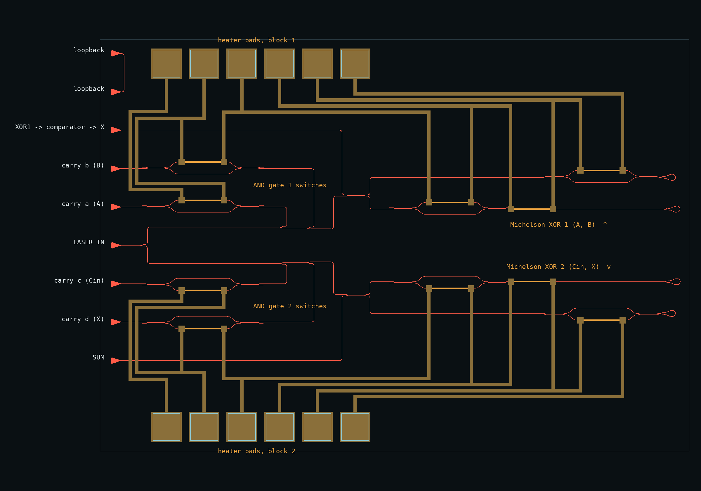
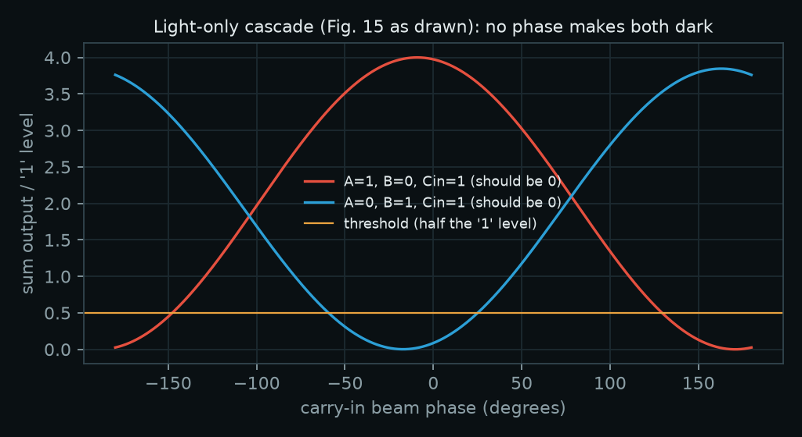
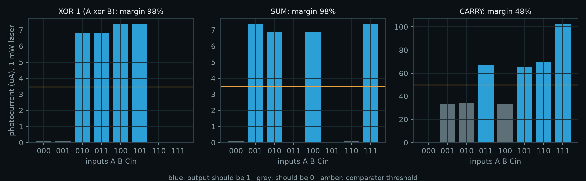
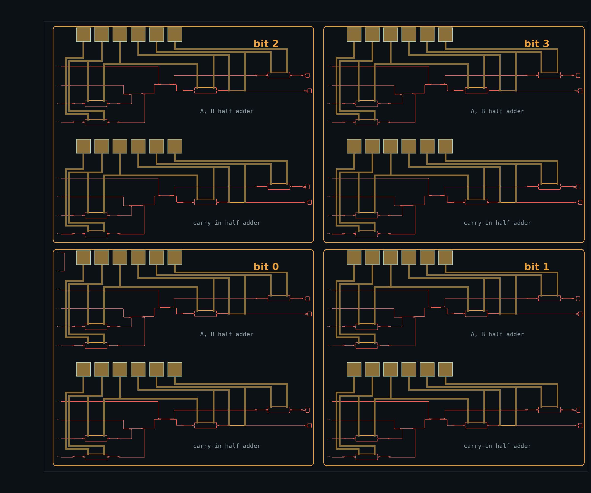
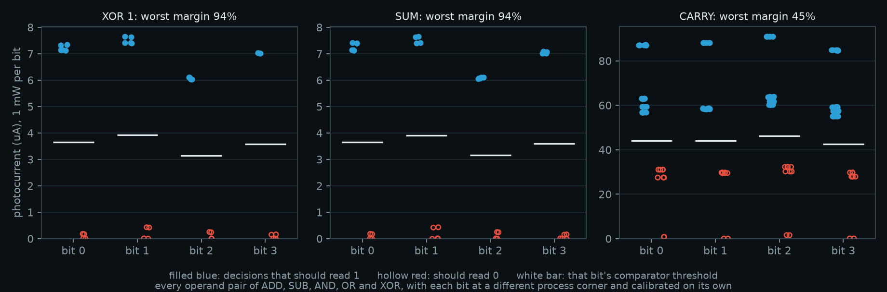

# Optical full adder chip and 4-bit ALU

A silicon photonic version of the full adder in *Using Polarisation and Interference for Optical Computing* (Section 4.2, Figures 15–16), designed for the SiEPIC EBeam process run by Applied Nanotools: 220 nm silicon waveguides, TiW heaters (M1) and a metal routing layer (M2).



The layout is a native KLayout / SiEPIC-Tools design, `klayout/EBeam_heaters_atharvdubey_FullAdder.gds` (and `.oas`, the fabrication export). It measures 1.87 × 1.60 mm and holds 113 components, ten grating couplers and twelve probe pads. It passes SiEPIC-Tools' functional verification with 0 errors. It has not been fabricated.

Four copies of it make a 4-bit ALU (ADD, SUB, AND, OR, XOR) on one 3.72 × 3.08 mm die: see [4-bit ALU](#4-bit-alu) below.

The 4-bit ALU can be tried as a calculator on the [ALU page](../alu/), and the project is summarised in [`CONCEPT.md`](../CONCEPT.md).

How fast the interference logic itself can compute is in [`speed/`](speed/README.md): a single-pass version of the paper's XOR runs at 200 Gb/s with 100 GHz modulators and adds 5 ps.

Open either layout in KLayout with SiEPIC-Tools and the SiEPIC EBeam PDK installed. The EBeam technology then gives the layer colours and the PCells, so every waveguide and heater stays editable.

## From the bench to the chip

| Bench (Fig. 15/16) | Chip |
|---|---|
| Laser | External 1550 nm laser, split 50/50 in fibre into the two blocks' grating couplers |
| S1 (1): carry-in light | The fibre splitter (each block has its own laser coupler; see below) |
| S2 (2), S3 (3): inputs A, B for AND gate 1 | Y-branch taps Sa, Sb in block 1 |
| S4 (8) with mirrors 7, 9: XOR gate 1 | Michelson interferometer: broadband directional coupler, Sagnac loop mirrors |
| S5 (10), S6 (13) with mirrors 11, 12: AND gate 2, XOR gate 2 | Block 2, the same circuit as block 1 |
| Blocking a beam to set an input | Thermo-optic Mach–Zehnder switch in that branch or interferometer arm |
| Polarisers marking the intensities | The same switches, set to partial transmission |
| One "OR" photoresistor for the carry | Four carry outputs on photodiodes wired in parallel, so their currents add |
| Lenses, screen and hole on a dark fringe | Interferometer output port biased dark with a heater |
| Arduino threshold | Comparators |

### One change from Figure 15

The figure sends XOR 1's light into XOR 2. That cannot work with light alone. XOR 1 is dark when A and B are both open because their light arrives with opposite phase. So "only A" and "only B" leave XOR 1 with opposite phase (172° apart in the simulation). When that light is combined with the carry-in beam, one of the two cases cancels and the other doubles. No carry-in phase or power fixes both (below).

On the chip, XOR 1 is therefore read by a photodiode and comparator. Its result, X, drives the X switches of block 2, in the same way the bench's Arduino applied its threshold. Everything else follows the paper's arrangement.



### Two test circuits

SiEPIC's automated test station uses one laser fibre and three detector fibres: one coupler above the laser input and two below it, at 127 µm pitch (the `DFT_Phot1x` design-for-test rules). Each block is therefore its own test circuit:

| Block 1 (A, B): the paper's half adder | Block 2 (Cin, X): the second half adder |
|---|---|
| y = 381 µm: XOR 1 (detector) | y = −381 µm: SUM (detector) |
| y = 254 µm: LASER 1 (`opt_in` label) | y = −508 µm: LASER 2 (`opt_in` label) |
| y = 127 µm: carry branch a, input A | y = −635 µm: carry branch c, Cin |
| y = 0 µm: carry branch b, input B | y = −762 µm: carry branch d, X |

This is the textbook full adder of the paper's Figure 12: two half adders, with their carries combined. Here the carries are combined by adding photocurrents. For use as one adder, one laser feeds both blocks through a 50/50 fibre splitter. A loopback pair at y = 508 and 635 µm is for aligning the fibre array.

## Simulation

`full_adder_sim.py` simulates the chip exactly as drawn. `klayout/full_adder_siepic.py` runs SiEPIC-Tools' net extraction on the layout (which pins touch which) and writes `klayout/extracted_netlist.json` with every component and every waveguide's drawn length. The simulation turns that file into one SAX scattering network, so the topology is never typed in by hand.

- **Component models:** the SiEPIC EBeam PDK compact models, via simphony 0.7.3. These cover the grating couplers, Y-branches, broadband couplers and waveguides.
- **Heaters:** waveguide sections with a phase shifter.
- **Terminators:** matched loads.
- **Back-reflections:** included.
- **Calibration:** heaters are calibrated per chip with sweeps that only read grating-coupler outputs.
- **Detection:** off-chip InGaAs photodiodes (1 A/W), 2 pA/√Hz amplifier noise, 1 MHz bandwidth, −140 dB/Hz laser intensity noise.

**All eight inputs, 1 mW of laser light before the 50/50 split** (photocurrents in µA):

| A B Cin | X (XOR 1) | XOR 1 | SUM | CARRY |
|---|---|---|---|---|
| 0 0 0 | 0 | 0.17 | 0.17 | 0.0 |
| 0 0 1 | 0 | 0.17 | 7.65 | 31.9 |
| 0 1 0 | 1 | 7.85 | 7.79 | 34.2 |
| 0 1 1 | 1 | 7.85 | 0.00 | 65.4 |
| 1 0 0 | 1 | 7.65 | 7.79 | 31.9 |
| 1 0 1 | 1 | 7.65 | 0.00 | 63.1 |
| 1 1 0 | 0 | 0.00 | 0.17 | 66.4 |
| 1 1 1 | 0 | 0.00 | 7.65 | 98.3 |



**Decision margins**, with thresholds set midway between the highest 0 and the lowest 1:

| Output | Contrast | Margin | Laser power drift tolerated |
|---|---|---|---|
| XOR 1 | 16.6 dB | 98% | ±49% |
| SUM | 16.6 dB | 98% | ±49% |
| CARRY | 2.7 dB | 46% | ±23% |

- **Laser power:** every output reaches Q ≥ 7 (one error in 10¹²) from 3.7 µW of laser power. Optical noise is not the limit; leakage through the switches is.
- **Bias tolerance:** both Michelson biases tolerate ±59° of error.
- **Process corners:** at all nine PDK thickness (210/220/230 nm) and width (480/500/520 nm) corners, all outputs are correct, with carry margins of 44–50%. This holds even with the nominal chip's heater settings, because the two arms of each Michelson are drawn to equal length.

**Carry marking.** The paper's AND-OR marking (Fig. 5) works. With the AND gate 2 branches each weighted half of the AND gate 1 branches, the carry margin is 21%.

The simulation also finds a better marking. With equal weights on A, B and Cin, and the X branch off, the carry detector computes majority(A, B, Cin), which equals the full-adder carry. The margin rises to 46%, and the carry no longer waits for the XOR 1 comparator. The X branch switch stays on the chip, so both markings can be tested.

## Layout and checks

`klayout/full_adder_siepic.py` builds the layout with SiEPIC-Tools (the drawing code is `klayout/builder.py`, shared with the ALU) from the EBeam library:

- `GC_TE_1550_8degOxide_BB` grating couplers;
- `ebeam_y_1550` Y-branches;
- `ebeam_bdc_te1550` broadband couplers;
- `ebeam_terminator_te1550` terminators;
- the `wg_heater` PCell (TiW heater, 120 µm) and `ebeam_BondPad` pads;
- `Waveguide` PCells ('Strip TE 1550 nm, w=500 nm') for every waveguide.

**Switches:** each is two broadband couplers with arms spread 40 µm apart and a heater on one arm. The arms are mirror images, so they are equal in length.

**Heater wiring:** five heaters per block are wired to six pads. Adjacent heaters share a pad, which keeps the single metal layer planar; each heater sees the voltage difference between its two pads (`klayout/build_report.json`).

**Labels:** `opt_in` labels for the automated test and `elec_` labels on the pads.

Checks, all passing:

- **SiEPIC-Tools functional verification** (`layout_check`, with the `DFT_Phot1x` design-for-test rules): 0 errors. Report in `klayout/EBeam_heaters_atharvdubey_FullAdder.lyrdb`.
- **In the build script:** no waveguide crossings (silicon shared between two instances only at pins) and no unconnected optical pins.
- **`verify.py`**, the rules of the SiEPIC EBeam DRC deck, reimplemented with the KLayout API:
  - Si width ≥ 60 nm and space ≥ 70 nm;
  - M1 width and space ≥ 3 µm;
  - M2 width ≥ 5 µm and space ≥ 8 µm;
  - pad openings ≥ 10 µm;
  - M2-over-M1 overlap ≥ 3 µm;
  - all silicon inside the floor plan;
  - 12 metal nets, each with exactly one pad;
  - each of the 10 heaters on exactly two nets;
  - no metal near a grating coupler.

- **The PDK's own DRC decks**, run with the KLayout DRC engine by `klayout/run_drc.py` (reports in `klayout/fa/drc/`):

  | Deck | Rules | Violations |
  |---|---|---|
  | `SiEPIC_EBeam_DRC`, the process deck | 14 | **0** |
  | `ELEC463 Metal Heater` (course "Chip1") | 5 | 0 |
  | `ELEC463 Doping` (course "Chip2") | 10 | 140, all `M_Si_separation` |

  The process deck is the one that applies. The ELEC463 decks belong to a university course: the Metal Heater deck checks metal on layer 47/0, which this design does not use, and the Doping deck is for a doped-silicon heater process that forbids metal over waveguides, so it flags every metal heater (14 markers per heater).

The first draft of this layout, drawn with gdsfactory, is in the git history (commit db5fa41).

## 4-bit ALU



`klayout/EBeam_heaters_atharvdubey_ALU4.gds` (and `.oas`) holds four full adders in a 2 × 2 grid: bit 0 bottom-left, bit 1 bottom-right, bit 2 top-left, bit 3 top-right. Each bit is the verified full adder, unchanged. The die is 3.72 × 3.08 mm with 443 components, 34 grating couplers (four per test circuit, eight test circuits, plus the alignment loopback pair), 40 heaters and 48 probe pads.

**How the bits are chained.** The bits share no light. Bit i's carry photocurrent goes to a comparator, and the comparator drives bit i+1's carry-in heaters. This is the same hybrid step that already carries XOR 1 into XOR 2 inside each adder. The electronic controller that does this also picks the operation:

| Operation | What the controller does | Result read from |
|---|---|---|
| ADD, A + B + cin | carry-in of bit 0 = cin; carries ripple | SUM of each bit, carry out |
| SUB, A − B | inverts B in the heater driver, carry-in of bit 0 = 1 (two's complement) | SUM; carry out 1 means no borrow |
| AND | every carry-in = 0 | CARRY, since majority(A, B, 0) = A and B |
| OR | every carry-in = 1 | CARRY, since majority(A, B, 1) = A or B |
| XOR | nothing extra | XOR 1 of each bit |

AND and OR need no extra optics because the carry unit computes majority(A, B, Cin) (the equal-weight marking above).

**Layout checks**, all passing (`klayout/alu4_build_report.json`, `klayout/alu4/drc/`):

- SiEPIC-Tools functional verification with the `DFT_Phot1x` rules: 0 errors. Each half of each bit is its own automated-test circuit (`opt_in_..._ALU4_Bit{0-3}_Half{1,2}`); the rows are 1524 µm (12 × 127 µm) apart, so one fibre-array column reaches every circuit in a column of bits.
- The four bits are identical: same 110 parts, same drawn lengths, checked in the build script.
- No waveguide crossings, no unconnected optical pins.
- `verify.py`: every rule passes; 48 metal nets with one pad each; each of the 40 heaters on two nets.
- PDK DRC decks: `SiEPIC_EBeam_DRC` 0 violations over 14 rules; `ELEC463 Metal Heater` 0; `ELEC463 Doping` 560 `M_Si_separation`, which is the same not-applicable flag on every heater.

**Simulation** (`alu4_sim.py`, results in `alu4_results.json`). Each bit is simulated from its own circuit in the SiEPIC extraction of the ALU layout, and each matches the single full adder to 1e-15. The controller is modelled as it would be built: comparator thresholds are fixed per bit after calibration, every decision sees detector noise, and the carry ripples bit to bit. Each bit gets 1 mW of laser (a 4 mW laser split eight ways). Every die below runs 1,536 operations: ADD with both carry-ins, SUB, AND, OR and XOR, each over all 256 operand pairs.

| Die | Wrong results | Worst decision margin | Minimum laser, whole ALU |
|---|---|---|---|
| Nominal (220 nm silicon, 500 nm waveguides) | 0 of 1,536 | 45.7% | 15 µW |
| Stressed: each bit at a different corner (±10 nm thickness, ±20 nm width), calibrated per bit | 0 of 1,536 | 45.4% | 19 µW |
| Stressed, nominal heater settings, per-bit thresholds | 0 of 1,536 | 3.0% (bit 3 carry) | 108 µW |
| Stressed, nominal heater settings and thresholds (no calibration) | 731 of 1,536 | fails | – |

The stressed die has far more variation between bits than a real 3.7 mm die. It still works once each bit is calibrated on its own, which is the usual procedure for heater-tuned circuits. Setting only the thresholds per bit barely works, and skipping calibration fails: bit 2's XOR 1 level drops under the shared threshold and the wrong X corrupts its SUM.



**Speed.** The interference logic is fast; the heaters are not (see [`speed/`](speed/README.md) for the logic at 200 Gb/s). Each carry hop is one comparator and one heater switching time. A 4-bit add therefore takes about five heater switching times (set the inputs, then four hops), which is tens of microseconds per hop for thermal heaters. Like the single adder, the ALU shows the logic, not speed.

## Testing a fabricated chip

1. Align the fibre array on the loopback pair.
2. Laser at 1550 nm on LASER 1 and LASER 2, or on one at a time for the automated station.
3. Calibrate the heaters in this order:
   - each AND switch, sweeping it on its own output;
   - each Michelson's arm switches, with a 2D sweep at a bright bias;
   - the biases, both arms on, minimising the output;
   - the carry marking.

   `Chip.calibrate()` is the reference procedure.
4. Apply A and B. Read XOR 1, threshold it, and apply the result to X along with Cin. Read SUM, and read CARRY as the sum of the four carry photocurrents.

## Limits

- No full-wave electromagnetic simulation beyond what the PDK models contain.
- Heater thermal crosstalk is not modelled; heaters are at least 90 µm apart.
- Heater power and switching speed depend on the TiW process and must be measured. Thermal switches settle in tens of microseconds, so this chip shows the logic, not speed.
- Waveguide loss (3 dB/cm) is an assumption.
- The die area must fit the run's submission template. At 1.87 × 1.60 mm (full adder) and 3.72 × 3.08 mm (ALU), both are larger than the 605 × 410 µm cells of the SiEPIC course runs.
- The ALU's carry chain and operation select are an electronic controller (comparators, heater drivers), modelled in `alu4_sim.py`, not drawn.

## Reproduce

```
pip install klayout siepic siepic_ebeam_pdk
python3 klayout/full_adder_siepic.py   # layout (.gds/.oas), SiEPIC verification, extracted netlist
python3 klayout/alu4_siepic.py         # 4-bit ALU layout, same checks
python3 klayout/run_drc.py klayout/EBeam_heaters_atharvdubey_FullAdder.oas klayout/fa     # PDK DRC decks (needs the klayout executable)
python3 klayout/run_drc.py klayout/EBeam_heaters_atharvdubey_ALU4.oas klayout/alu4
pip install -r requirements.txt
python3 verify.py                      # design-rule and electrical checks (add a .gds path for the ALU)
python3 full_adder_sim.py              # about 20 minutes; full_adder_results.json
python3 alu4_sim.py                    # about 6 minutes; alu4_results.json
python3 figures.py
python3 render_chip.py
python3 alu4_figures.py
```
