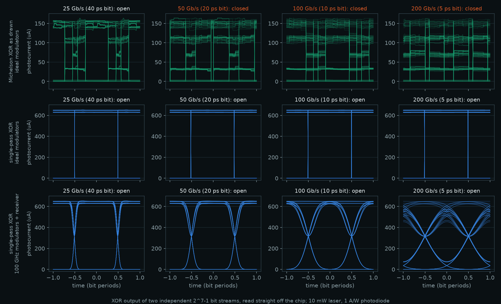
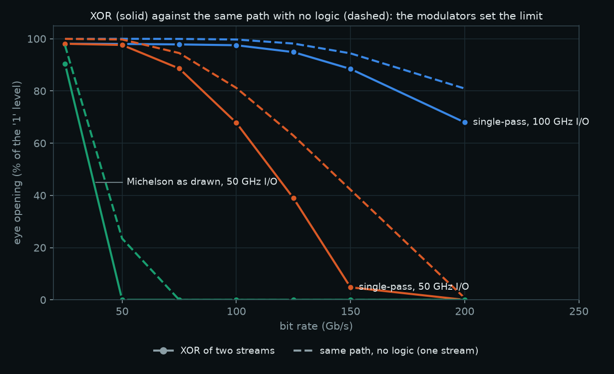

# How fast does the interference XOR compute?

The paper's XOR computes by interference: two beams meet at a coupler and cancel or add. Nothing in that step has to switch, charge or wait for a clock, so the logic itself should keep up with whatever data rate the inputs can be put on light. This study tests that claim on the layouts, in the time domain.

**Result.** A single-pass version of the paper's XOR computes on two independent bit streams at 200 Gb/s with realistic 100 GHz modulators and receivers, and at 400 Gb/s with ideal ones. Those are the highest rates simulated, and the gate's spectrum says it would go further. The gate adds 5.2 ps from modulator to coupler. With 100 GHz modulators, at every rate up to 200 Gb/s, its output eye stays within 0.8 dB of the same light path with no logic in it (0.15 dB or less up to 125 Gb/s), so the speed limit is the modulators and the detector, not the computation.



## Two XOR circuits

- **Michelson, as drawn.** XOR 1 of the full adder (`../klayout/EBeam_heaters_atharvdubey_FullAdder`), the paper's geometry: each arm ends in a loop mirror, so light crosses its input switch twice, once out and once back.
- **Single-pass.** `../klayout/EBeam_heaters_atharvdubey_FastXOR` is the same two-beam XOR with the arms recombined at a second coupler instead of folded back. Arm B is the mirror image of arm A (420.494 µm each). The layout passes SiEPIC verification with 0 errors and the PDK's process DRC with 0 violations (`../klayout/fast_xor/drc/`).

Both are passive silicon on the EBeam process, and their input switches are heaters. Here the switches are driven as fast phase modulators of the same geometry. That is the same circuit built in a process that has depletion or lithium-niobate modulators.

## How it is simulated

`td.py` turns the SiEPIC extraction of each layout into a time-domain scattering network:

- every drawn waveguide becomes a delay line with its drawn length, the PDK waveguide's group delay (n_g = 4.19) and its complex transmission at 1550 nm;
- couplers, Y-branches and grating couplers keep their PDK S-matrices;
- each heater section is a phase that can change in time;
- back-reflections are included.

With the inputs held still, the time-domain model reproduces the frequency-domain simulation to every digit printed, for all four input states of both circuits.

`speed_study.py` then drives A and B with two independent 2^7−1 bit streams and reads the XOR output with a photodiode (1 A/W, 20 pA/√Hz amplifier, 10 mW laser into the chip). It sweeps the bit rate with three kinds of modulator and receiver: ideal, 50 GHz (silicon class) and 100 GHz (lithium-niobate class). Every XOR run is repeated with B switched off: the same light path carrying one stream, with no logic. The difference between the two is the penalty of the logic.

A rate counts as working when the eye at its centre gives Q ≥ 7 (bit error rate ≤ 1e-12) and stays open for at least 30% of the bit.

## Results

| Circuit | Modulators and receiver | Fastest working rate | XOR penalty over the no-logic path |
|---|---|---|---|
| Michelson as drawn | ideal | 25 Gb/s | ≤ 0.3 dB |
| Michelson as drawn | 50 GHz | 25 Gb/s | 0.3 dB |
| Single-pass | ideal | ≥ 400 Gb/s (highest simulated) | 0.07–0.09 dB at every rate |
| Single-pass | 100 GHz | ≥ 200 Gb/s (highest simulated) | ≤ 0.15 dB up to 125 Gb/s, 0.8 dB at 200 Gb/s |
| Single-pass | 50 GHz | 125 Gb/s (no-logic path: 150 Gb/s) | 0.8 dB at 100 Gb/s, 2.1 dB at 125 Gb/s |



**Why the drawn Michelson stops at 25 Gb/s.** A change at an input switch reaches the output twice: 14.1 ps later on the way out, and 33.0 ps later after the loop mirror. With bits shorter than about 19 ps the two passes see different bits, and the output mixes them; this is the staircase in the top row of the eye diagrams. The Michelson is right for heaters, which hold still, and wrong for fast data.

**Why the single-pass XOR costs almost nothing.** Each modulator is crossed once, 19.0 ps before the light reaches the output fibre. Of that, 5.2 ps is the gate (modulator, bias section, coupler) and 13.8 ps is the 985 µm waveguide that carries the result back to the fibre array. The arms are equal, so A and B meet in step.

The one cost appears when the modulators are slow compared with the bit. If A turns on while B turns off, both are half on for a moment, and they cancel at the coupler. That shows up as a dip in the "1" level, visible in the bottom row of the eye diagrams. With 100 GHz modulators it costs 0.15 dB or less up to 125 Gb/s; with 50 GHz modulators it grows to 2.1 dB at 125 Gb/s.

**Bandwidth of the gate itself** (frequency domain, every component dispersive):

| Band around 1550 nm | ±1 nm | ±5 nm | ±10 nm | ±20 nm |
|---|---|---|---|---|
| Single-pass: worst on/off ratio | 35.6 dB | 34.1 dB | 30.5 dB | 23.5 dB |
| Michelson: worst on/off ratio | 14.6 dB | 14.3 dB | 12.4 dB | 5.4 dB |

±10 nm is ±1.25 THz. The single-pass XOR keeps a 30 dB on/off ratio over that whole band, wider than a 400 Gb/s signal occupies. The Michelson's ratio is lower everywhere because its switches leak twice.

## What this shows, and what it doesn't

- **It shows** that the computation in the paper's XOR adds only a few picoseconds and has no bandwidth of its own worth speaking of. One gate handles a 200–400 Gb/s serial stream directly. Electronic logic would first split a stream that fast into parallel lanes, because no single CMOS gate toggles at hundreds of GHz.
- **It doesn't show** that optics beats a CPU at arithmetic. A CMOS gate's delay is also a few picoseconds, and multi-bit logic still needs the electronic carry step found in the ALU. The advantage is per-gate data rate and no clock, for data that is already light.
- **The inputs must be coherent.** Both streams must ride on the same laser, here one laser split into two modulators, because the XOR is interference.

## Eight inputs: phase-encoded parity

`parity_speed.py` runs the same model on the parity chip (`../klayout/EBeam_heaters_atharvdubey_Parity8`): eight independent random streams on eight phase sections of one arm, and their parity read at the output. The drives are aligned to the light's travel time, 14.7 ps from the first section to the last. With ideal modulators the eight-input gate costs 0.01 dB over a plain waveguide up to 400 Gb/s. With 100 GHz modulators it runs at 150 Gb/s (a single stream: 200). With 50 GHz modulators it runs at 75 Gb/s (a single stream: 150). The slow phase edges of eight sections add up. Without alignment it fails above 25 Gb/s. Details in [the chip README](../README.md#phase-encoded-parity).

## Sixteen inputs: the optical neuron

`perceptron_speed.py` runs the same model on the neuron chip (`../klayout/EBeam_heaters_atharvdubey_Perceptron16`). A stream of 3 × 5 pixel digit images drives its sixteen arms, one whole image per bit slot, with the weights holding a stored 7. The output is a ladder of levels, one per value of the weighted sum, and the neuron fires above a threshold. With the drives aligned to each section's place along its arm (up to 14.7 ps apart), every level stays apart to 100 G images/s with 100 GHz modulators, and the fires-on-7 decision holds at Q ≥ 7 to 100. With 50 GHz modulators it is 50 and 75, and 200 with ideal ones. Without alignment it fails above 25. Details in [the chip README](../README.md#optical-neuron).

## Limits

- The modulators are lumped phase sections at the heaters' places. Real high-speed modulators are longer (millimetres for silicon depletion) and need travelling-wave electrodes. Their bandwidth is modelled as a Gaussian filter: ideal, 50 GHz or 100 GHz.
- In the time domain the couplers' and grating couplers' responses are taken at 1550 nm. The frequency-domain table above includes their wavelength dependence and shows it is small across the band a 400 Gb/s signal uses.
- Noise is detector shot noise and amplifier noise; laser phase noise doesn't matter for a single laser split into equal arms. No thermal drift, and no fabrication variation between the two arms.
- 2^7−1 bit patterns, 254 bits per run; Q is computed from the worst-case eye.

## Reproduce

```
python3 ../klayout/fast_xor_siepic.py            # single-pass XOR layout + checks
python3 ../klayout/run_drc.py ../klayout/EBeam_heaters_atharvdubey_FastXOR.oas ../klayout/fast_xor
python3 speed_study.py                            # about 8 minutes; speed_results.json, speed_eyes.npz
python3 figures.py
python3 parity_speed.py                           # about 6 minutes; parity_speed_results.json, parity_eyes.npz
python3 perceptron_speed.py                       # about 15 minutes; perceptron_speed_results.json, perceptron_eyes.npz
```
